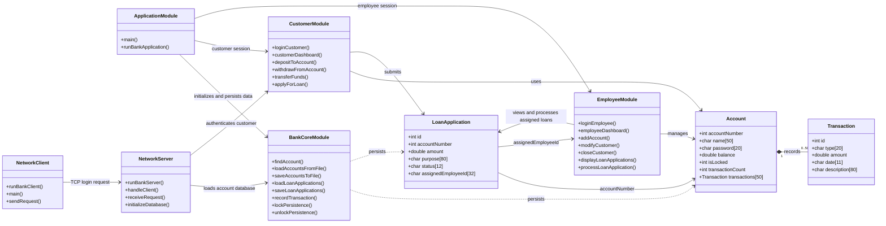

# Design and Development of Banking Management System

This project is a simplified banking management system developed in C. It simulates key banking operations such as creating accounts, depositing money, withdrawing funds, and viewing account records through a console-based interface.

## Project Overview

The system includes:
- Customer account creation
- Deposit and withdrawal operations
- Employee login and customer account administration
- Loan application submission, review, and processing
- Concurrent TCP client access to authenticated account details
- Balance checking
- Customer transaction history and fund transfers
- Menu-driven C application flow

## System Blueprint

The project uses C structs and function modules rather than object-oriented classes. This class-style diagram shows the data relationships and the responsibilities of each source module.



## Essential Tools Installed

The following development tools were installed so the project can run correctly in this Windows environment:

- MinGW GNU Compiler Collection (GCC)
- WinLibs POSIX UCRT toolchain package
- Standard command-line build support for C programs

Installation command used:

```powershell
winget install --id BrechtSanders.WinLibs.POSIX.UCRT -e
```

This provides the `gcc` compiler required to build and run the project.

## Verified Compiler Check

The compiler was confirmed working with:

```powershell
gcc --version
```

## Project Files

```text
Design-and-Development-of-Banking-Management-System/
├── README.md
├── include/
│   ├── application.h
│   ├── bank_core.h
│   ├── customer.h
│   ├── employee.h
│   ├── server.h
│   └── client.h
├── src/
│   ├── application.c
│   ├── bank_core.c
│   ├── customer.c
│   ├── employee.c
│   ├── server.c
│   └── client.c
├── Makefile
├── banking_management_system.exe
├── bank_server.exe
└── bank_client.exe
```

## Build Instructions

Open PowerShell in the project folder and build all three executables:

```powershell
mingw32-make
```

The equivalent individual compiler commands are:

```powershell
gcc -Wall -Wextra -std=c11 -Iinclude src/application.c src/bank_core.c src/customer.c src/employee.c -o banking_management_system.exe
gcc -Wall -Wextra -std=c11 -Iinclude src/server.c src/bank_core.c src/customer.c -lws2_32 -o bank_server.exe
gcc -Wall -Wextra -std=c11 -Iinclude src/client.c -lws2_32 -o bank_client.exe
```

Run the original local console application with:

```powershell
.\banking_management_system.exe
```

## Network Server

The optional Windows TCP server lets multiple customer clients connect concurrently. It uses Winsock for networking and creates a Windows thread for each accepted client. Each client must authenticate with an account number and password; the server returns only that account's number, name, and balance. The server reads the shared `bank_accounts.dat` file for each request, so account changes made by the console application are visible without restarting the server.

Start the server in one PowerShell terminal:

```powershell
.\bank_server.exe
```

The server listens on TCP port `5050` on available network interfaces. To use another port, pass it as the first argument, for example `.ank_server.exe 5051`. Start a client in another terminal:

```powershell
.\bank_client.exe 127.0.0.1 5050
```

For clients on another machine, replace `127.0.0.1` with the server machine's IP address and allow the selected TCP port through Windows Firewall. Multiple clients can start their own client process and connect at the same time. Stop the server with Ctrl+C.

Account and loan file access is serialized with a named Windows mutex shared by the console application and server. This prevents simultaneous file reads/writes from racing. The network protocol sends credentials in plaintext and is intended only for trusted development networks; use TLS and proper credential protection before exposing a real banking service.

The network service uses Windows system APIs where concurrency and networking require them: Winsock for TCP, `CreateThread` for client handling, and a named mutex for cross-process persistence coordination. Process management, semaphores, and other IPC mechanisms are not needed by this single-server design. Existing C file serialization remains in the shared persistence functions.

## Features Included in the Current Version

- Customers can log in, view balances and transaction history, deposit, withdraw, transfer funds, and submit loan applications.
- Employees can list accounts, add customers, modify customer names or passwords, close accounts, view assigned loan applications, and approve or reject their assigned applications.
- Approving a loan credits the customer's account and records the credit in transaction history. Accounts with pending loan applications cannot be closed.
- Each customer login is tracked as a single active session until logout. This console application handles one interactive session at a time.
- Account data remains in `bank_accounts.dat`; loan applications are stored separately in `loan_applications.dat`.

## User Roles

### Customer
Customers log in with their account number and password. Sample accounts are created on first run when no account data file exists: `1001 / pass1001`, `1002 / pass1002`, and `1003 / pass1003`.

### Bank Employee
Select **Employee Login** from the main menu, then sign in with the demonstration credentials:

```text
Employee ID: employee
Password:   staff123
```

From the employee dashboard, select **Add New Customer** to open an account; the system generates an account number automatically, starting at `1001` and continuing above the highest existing number. Select **Modify Customer Details** to change a customer's name or password, or **Close Customer Account** to close an account after confirmation. An account must have a zero balance and no pending loan applications before it can be closed. Use **View Assigned Loan Applications** to inspect applications assigned to your employee ID, then **Approve/Reject Assigned Loan Application** to process a pending application by its ID. Approval credits the requested amount to the customer's account. New and previously saved applications are assigned to the demo employee ID `employee` because the system currently has one employee login.

Customer and employee dashboards end with a logout option, which returns to the main menu. The employee credentials are hard-coded demonstration credentials and must be replaced with secure credential storage before real-world use.

## Notes

This is a beginner-friendly C project that helps with structured programming, arrays, function design, file persistence, and menu-based console application development. The binary data files are local demo storage, not a secure production database.
