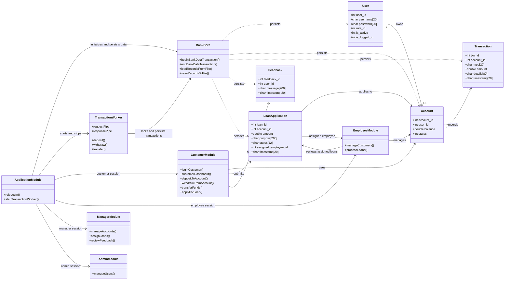

# Banking Management System

This project is a file-backed, console banking demo written in C. It has customer, manager, employee, and admin roles, and uses POSIX file locks, pthreads, and pipes to coordinate concurrent transactions.

## Project Overview

The current build includes role-based workflows, account and loan administration, feedback, and transaction history. Its file-backed records are stored separately, and all banking transactions pass through a worker thread.

## System Blueprint

The project uses C structs and function modules rather than object-oriented classes. This diagram summarizes the persisted records and the main runtime modules.



## Requirements

This version uses POSIX APIs (`fcntl`, `pthread`, and `pipe`) and must be built on Linux, macOS, or WSL. On Windows, use a WSL Linux distribution with GCC and GNU Make installed.

## Project Files

```text
Banking-Management-System/
├── README.md
├── docs/
│   └── schema.png
├── include/
│   ├── admin.h
│   ├── application.h
│   ├── bank_core.h
│   ├── customer.h
│   ├── employee.h
│   └── manager.h
├── src/
│   ├── admin.c
│   ├── application.c
│   ├── bank_core.c
│   ├── customer.c
│   ├── employee.c
│   ├── manager.c
│   └── transaction_worker.c
├── Makefile
└── .gitignore
```

## Build Instructions

From a Linux or WSL terminal, enter the project folder and build the console application:

```sh
cd /mnt/c/Users/Aditya_JU/Desktop/03-projects/software-system-project/Banking-Management-System
make
```

Run it from the project folder so the data files and lock file are found:

```sh
./banking_management_system
```

## Features Included in the Current Version

- Customers can view balances, deposit, withdraw, transfer funds, view transactions, apply for loans, and submit feedback.
- Managers can activate/deactivate accounts, assign loan applications to employees, and review feedback.
- Employees can create customers, modify customer details, view transactions, and approve or reject assigned loan applications.
- Admins can create employees, modify user details, change roles, and change passwords.
- User, account, transaction, feedback, and loan data are stored separately in `bank_users.dat`, `bank_accounts.dat`, `bank_transactions.dat`, `bank_feedback.dat`, and `bank_loans.dat`. These local runtime files are created on first run and are excluded from version control; back them up if you need to preserve your data.

## Concurrent data access

The application combines POSIX record locking and threads. `fcntl` locks a shared `.bank_data.lock` file to serialize data changes between processes; a `pthread_mutex_t` also serializes access between threads in one process, since POSIX `fcntl` record locks alone do not exclude sibling threads. Locked operations reload the latest file data before validation and mutation. Saves go to a temporary file and are renamed into place after a successful write.

Deposits, withdrawals, and transfers are submitted to a dedicated `pthread` worker through a pair of `pipe()` channels. The worker performs the balance and transaction-history updates while holding the data lock. Pipe requests are synchronous to the UI: it waits for the worker's result before reporting success. Build with `make`; the Makefile links the POSIX threads library with `-pthread`.

This remains a small file-backed demo, not a production banking database. An interruption between replacing separate data files (for example, balances and transaction history) may leave them inconsistent. Passwords are still stored in plain text; use a transactional database and password hashing for real deployments.

## User Roles

On first run, the program creates these demonstration users:

```text
Customer: alice / alice123
Manager:  manager / manager123
Employee: employee / emp123
Admin:    admin / admin123
```

Choose the corresponding role from the main menu, then enter that role's username and password. The default data is for demonstration only; passwords are stored as plain text and should not be used for a real banking service.

## Notes

This is a beginner-friendly C project that helps with structured programming, arrays, function design, file persistence, and menu-based console application development. The binary data files are local demo storage, not a secure production database.
